  

# 🧪 Awesome Testing Framework Integrations: Selenium, Cypress, Playwright & Cloud Automation 🚀

  
  
  
  
  

> 🌟 A curated directory and architectural guide to top **Testing Framework Integrations** — featuring enterprise SaaS cloud testing platforms, managed browser grids, and open-source automation frameworks for **Playwright, Cypress, Selenium, Appium**, and modern QA workflows.  
> 
> ⭐ *Star this repository if you find it helpful!* ⭐

---

## 📋 Table of Contents 📑

- [🌐 Sector Overview & Market Dynamics](#-sector-overview--market-dynamics)
- [☁️ SaaS & Cloud Testing Platforms](#️-saas--cloud-testing-platforms)
- [💻 Open-Source Software & Frameworks](#-open-source-software--frameworks)
- [📊 Framework Feature Matrix](#-framework-feature-matrix)
- [💡 Architecture & Integration Patterns](#-architecture--integration-patterns)
- [📈 Star History](#-star-history)
- [💖 Support & Community](#-support--community)
- [🤝 Contributing](#-contributing)
- [📄 License](#-license)

---

## 🌐 Sector Overview & Market Dynamics 📈

The global **cloud testing and test automation market** is valued between **$13 Billion and $24 Billion** (with cloud testing at ~$13–14B and broader software test automation exceeding $20B), expanding at a compound annual growth rate (CAGR) of **11.2% to 16.9%** toward a projected **$35B–$80B+** by the early 2030s.

The sector is **moderately to highly fragmented**: while foundational driver ecosystems are anchored by key open-source engines (Playwright, Cypress, Selenium), commercial execution infrastructure is split among specialized cross-browser/real-device clouds (BrowserStack, Sauce Labs, LambdaTest), test-management systems, and enterprise legacy quality suites (Tricentis, OpenText), with increasing market competition driven by AI-native test generation and autonomous self-healing execution.

---

## ☁️ SaaS & Cloud Testing Platforms 🚀

Commercial, cloud-hosted test execution grids and automated cross-browser/device testing platforms. The table below is sorted in descending order of company scale (valuation / enterprise revenue).

| 🏢 Platform | 💰 Valuation / Revenue Scale | 🏷️ Starting Price | 🎁 Free Tier / Trial Limits | 🔌 Key Framework Integrations | 🎯 Best For |
|---|---|---|---|---|---|
| **[BrowserStack Automate](https://www.browserstack.com/automate)** | **~$4.0B Valuation** (~$230M ARR) | **$129/mo** (billed annually; 1 parallel session) | **60-minute Free Trial** (no credit card required; free plans available for verified open-source projects) | Playwright, Cypress, Selenium WebDriver, Puppeteer, Appium, WebdriverIO | Enterprise-grade managed cloud browser & real-device grid at global scale |
| **[Sauce Labs](https://saucelabs.com/)** | **~$613M Valuation** (~$100M Revenue) | **$39/mo** (Live testing, billed annually; Automated Virtual Device Cloud starts at $149/mo) | **28-Day Free Trial** (60 automated/live testing minutes, up to 3 parallel VMs, 50 Sauce AI queries) | Selenium 4+ (CDP/BiDi), Cypress, Playwright, TestCafe, WebdriverIO, Appium | Mature enterprise test execution with Chrome DevTools Protocol (CDP) & BiDi debugging |
| **[LambdaTest (TestMu AI)](https://www.lambdatest.com/)** | **~$400M Valuation** (~$25M–$100M ARR range) | **$79/mo** (billed annually; baseline Web Automation) | **Free Forever Plan** (includes 100 lifetime automation minutes, 1 concurrent test session, 60 live test mins/mo) | Selenium, Playwright, Cypress, Puppeteer, Taiko, 46+ CI/CD frameworks | High-speed HyperExecute test orchestration with AI-powered authoring (KaneAI) |

---

## 💻 Open-Source Software & Frameworks 🛠️

Community-driven test automation frameworks, browser drivers, and test execution environments. The table below is sorted in descending order of GitHub star popularity.

| 📦 Project | ⭐ GitHub_Stars | 💻 Primary Language / Stack | 📜 License | 🔍 Core Focus & Architecture |
|---|---|---|---|---|
| **[Playwright](https://github.com/microsoft/playwright)** |  | TypeScript, JavaScript, Python, C#, Java | Apache 2.0 | Next-generation cross-browser E2E testing (Chromium, WebKit, Firefox) via internal browser socket connections with built-in auto-waiting, network mocking, and execution tracing. |
| **[Puppeteer](https://github.com/puppeteer/puppeteer)** |  | JavaScript, TypeScript (Node.js) | Apache 2.0 | High-level Chrome DevTools Protocol (CDP) node library for headful/headless Chromium automation, web crawling, and lightweight rendering validation. |
| **[Cypress](https://github.com/cypress-io/cypress)** |  | JavaScript, TypeScript | MIT | In-browser frontend E2E and component testing runner offering direct DOM access, automatic snapshotting, and synchronous time-travel debugging. |
| **[Selenium WebDriver](https://github.com/SeleniumHQ/selenium)** |  | Java, Python, C#, Ruby, JavaScript | Apache 2.0 | W3C-standardized multi-language browser automation engine driving native browser drivers (GeckoDriver, ChromeDriver) across distributed Selenium Grids. |
| **[Grafana k6](https://github.com/grafana/k6)** |  | Go, JavaScript runtime | AGPL 3.0 | Modern developer-centric load, performance, and hybrid browser automation (via `k6/browser`) testing tool designed for CI/CD pipelines. |
| **[Appium](https://github.com/appium/appium)** |  | JavaScript, TypeScript (Node.js) | Apache 2.0 | Cross-platform mobile automation standard for iOS and Android native, hybrid, and web applications using W3C WebDriver endpoints. |
| **[Robot Framework](https://github.com/robotframework/robotframework)** |  | Python | Apache 2.0 | Generic keyword-driven, tabular test automation framework with deep library ecosystems for Selenium, Playwright (Browser library), and API testing. |
| **[Nightwatch.js](https://github.com/nightwatchjs/nightwatch)** |  | JavaScript, TypeScript | MIT | Batteries-included E2E testing framework with built-in test runner, assertion engine, and native support for W3C WebDriver and Chrome DevTools Protocol. |
| **[TestCafe](https://github.com/DevExpress/testcafe)** |  | TypeScript, JavaScript | MIT | Zero-configuration proxy-based Node.js E2E testing tool that executes tests across any browser without installing external WebDriver binaries or browser plugins. |
| **[WebdriverIO](https://github.com/webdriverio/webdriverio)** |  | TypeScript, JavaScript | MIT | Next-generation browser and mobile automation test framework running both WebDriver and Chrome DevTools Protocol under an extensible plugin ecosystem. |
| **[Allure 2 Test Reporting](https://github.com/allure-framework/allure2)** |  | Java | Apache 2.0 | Multi-language test reporting framework that unifies execution visual reports, attachments, and timeline analytics across Playwright, Cypress, and Selenium. |
| **[CodeceptJS](https://github.com/codeceptjs/CodeceptJS)** |  | JavaScript, TypeScript | MIT | Scenario-driven BDD-style testing framework providing unified abstraction helpers over Playwright, WebDriver, Puppeteer, and Appium backends. |
| **[Taiko](https://github.com/getgauge/taiko)** |  | JavaScript | Apache 2.0 | Free and open-source Node.js library for automating Chromium-based browsers with a clean, readable API that eliminates explicit waits. |
| **[Selenoid](https://github.com/aerokube/selenoid)** |  | Go | Apache 2.0 | Ultra-lightweight, lightning-fast implementation of the Selenium hub running browsers inside isolated Docker containers with minimal resource overhead. |

---

## 📊 Framework Feature Matrix ⚙️

| 🧩 Engine | 🏗️ Primary Architecture | ⚡ Execution Model | ⏳ Native Auto-Wait | 🌐 Cross-Browser Coverage | 📱 Mobile App Automation |
|---|---|---|---|---|---|
| **Microsoft Playwright** | CDP / WebKit / Firefox WebSocket | Out-of-Process Socket | ✅ Yes | Chromium, Firefox, WebKit | Emulation only |
| **Cypress** | In-Browser Execution Loop | Inside DOM Runtime | ✅ Yes | Chromium, Firefox, WebKit (Exp.) | Emulation only |
| **Selenium WebDriver** | W3C WebDriver HTTP Specification | Out-of-Process HTTP Server | ❌ Requires FluentWait | All major browsers | Via Appium |
| **Puppeteer** | Chrome DevTools Protocol (CDP) | Out-of-Process Socket | ⚠️ Partial | Chromium, Firefox (Exp.) | Emulation only |
| **WebdriverIO** | WebDriver & CDP Hybrid | Out-of-Process | ✅ Yes | All major browsers | Native iOS & Android |
| **Appium** | W3C Mobile JSONWP / WebDriver | Out-of-Process Client-Server | ⚠️ Configurable | Safari, Chrome, WebViews | Native iOS, Android & TV |

---

## 💡 Architecture & Integration Patterns 🧩

When selecting or integrating a modern testing framework stack, teams typically adopt one of three primary architectural integration models:

1. **Local Framework + Cloud Device Grid (Hybrid SaaS):**
   - The test runner and business test logic execute within CI/CD pipelines (GitHub Actions, GitLab CI, CircleCI).
   - Browser or mobile commands are streamed remotely via secure WebSockets / HTTPS tunnels (e.g., BrowserStack Local, Sauce Connect) to thousands of real desktop/mobile configurations.
2. **Containerized Open-Source Self-Hosted Grid:**
   - Organizations with strict compliance or cost requirements run on-premise grids using [Selenoid](https://github.com/aerokube/selenoid) or distributed [Selenium Grid](https://github.com/SeleniumHQ/selenium) on Kubernetes, eliminating external cloud dependency.
3. **Headless In-Container Runners (Shift-Left Fast Feedback):**
   - Developer-centric pipelines run [Playwright](https://github.com/microsoft/playwright) or [Cypress](https://github.com/cypress-io/cypress) headlessly directly inside containerized CI runners, uploading test artifacts (screenshots, traces, videos, [Allure 2](https://github.com/allure-framework/allure2) reports) to cloud object storage.

---

## 💖 Support & Community 🙏

Thank you so much for exploring this curated testing framework guide! If this project helps streamline your QA strategy, browser automation pipeline, or engineering workflows, here are a few great ways to support it:

- ⭐ **Star this repository** to help other engineers and QA teams discover it.
- 🍴 **Fork the repo** to contribute new benchmarks, framework adapters, and cloud integrations.
- 📢 **Share with your team** and automation community on LinkedIn, X, or Discord.
- ☕ **Buy a coffee or sponsor ongoing maintenance**:  
    
  Support directly through the [GitHub Sponsor Dashboard](https://github.com/sponsors/ishandutta2007)! Every contribution is deeply appreciated.

---

## 📈 Star History 🌟

---

## 🤝 Contributing 👥

Contributions are always welcome! To add another open-source testing tool or cloud framework platform:

1. Fork this repository.
2. Verify that the project is actively maintained (active releases or commits within the last 12 months).
3. Ensure open-source entries include the correct GitHub Stars_Badge linked to its `/stargazers` page.
4. Submit a Pull Request with a clear description and categorization.

---

## 📄 License ⚖️

This repository is curated and made available under the [CC0 1.0 Universal (Public Domain)](http://creativecommons.org/publicdomain/zero/1.0/) license. Individual tools, libraries, and frameworks retain their respective open-source or proprietary licenses.
